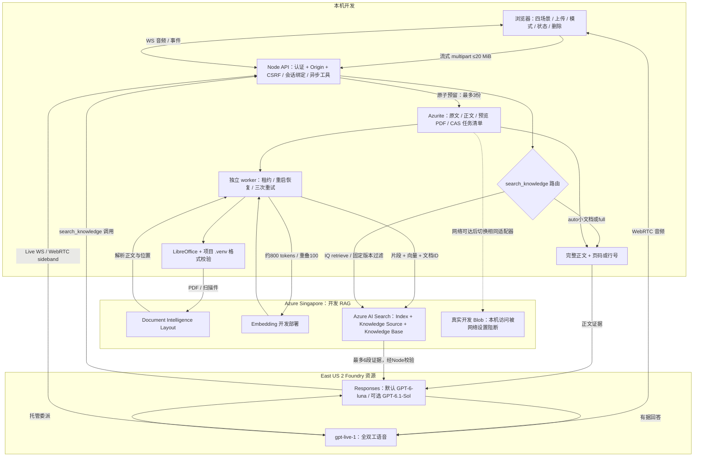

# GPT-Live 知识库：本地开发与联调

本地实现与首次生产发布准备于 2026-10-14。本文保留本机运行方法；生产环境使用独立 Blob 存储和 Container Apps Job，详见 [生产发布指南](PRODUCTION.md)。本机与生产文档互相隔离。

## 当前运行方式

访问 `http://localhost:3000`，选择第四个场景“知识库问答”。每个工作台共享一套持久知识库，最多三份文档，每份 20 MiB；处理中、失败和清理失败的文档均占名额。支持 `.doc/.docx/.pdf/.ppt/.pptx/.md/.markdown/.txt`。

本地 `.env` 已设置默认 Luna 与可选 Sol 部署与 Singapore 的 OCR、Embedding、Search。**当前 Blob 使用 Azurite**：实际开发 Storage 的 `publicNetworkAccess` 保持 `Disabled`，本机请求返回 403；通过 CLI 和 ARM 更新均未生效。没有宣称真实 Azure Blob 联调通过。Azure Blob 适配器保留，可在获准的网络路径可用后切换。

资料内容存于本地 `.knowledge-tmp/azurite`，解析、检索使用真实 Azure 服务。Azurite 是显式开发配置，不是生产失败时的自动降级。

## 启动

从项目根目录运行，保留现有 `.env`。仅首次设置 Python 环境时创建 venv：

```sh
npm ci
python3 -m venv .venv
.venv/bin/python -m pip install -r requirements-knowledge.txt
az login
```

LibreOffice 的 `soffice` 必须在 PATH，或在 `.env` 设置 `KNOWLEDGE_SOFFICE` 的绝对路径。macOS 的 headless LibreOffice 会显式加载系统字体，避免中文丢失。生产 `Dockerfile.worker` 已包含 LibreOffice、Noto CJK 字体与 `/app/.venv`。

启动三个终端：

```sh
# 终端 1：持久本地 Blob，绑定 127.0.0.1:10000
npm run knowledge:storage

# 终端 2：文档处理（固定调用 .venv/bin/python）
npm run knowledge:worker

# 终端 3：前端和后端
npm run dev
```

也可使用 `node --import tsx server/index.ts` 与 `node --import tsx server/knowledge/worker.ts`。Azure SDK 的 Entra 身份链可使用 `az login`。CLI 需要可写的个人凭据缓存/日志目录；不要将其提交到项目。

`.venv`、`.knowledge-tmp`、`output`、`.env` 均被 Git/Docker 忽略。Python 运行依赖在 `requirements-knowledge.txt`，生成测试文档的额外依赖在 `requirements-knowledge-test.txt`。所有安装命令必须使用项目 `.venv/bin/python -m pip`。

## 开发配置

完整变量见 `.env.example`。`scripts/configure-knowledge-dev.mjs --azurite` 可为本次已创建的资源更新本地 `.env`；脚本保留其它条目，不打印密钥。去掉 `--azurite` 会选择真实开发 Blob URL（当前网络限制尚未解决）。

| 配置 | 用途 |
|---|---|
| `RESPONSES_DEPLOYMENT` | 默认 `gpt-6-luna` |
| `RESPONSES_DEPLOYMENTS` | `gpt-6-luna,gpt-live-dev-sol`；Sol 别名对应 `gpt-6.1-sol`，版本 `2026-09-29` |
| `KNOWLEDGE_STORAGE_CONNECTION_STRING` | 本地设置 `UseDevelopmentStorage=true`；真实 Entra Blob 留空 |
| `KNOWLEDGE_STORAGE_URL` | 真实开发 Blob 服务地址 |
| `KNOWLEDGE_CONTAINER` | 工作台持久数据与任务清单的专属容器 |
| `KNOWLEDGE_SEARCH_ENDPOINT/KEY` | Azure AI Search；未设 KEY 则使用 Entra |
| `KNOWLEDGE_INDEX_PREFIX` | 专属 index/source/base 名称前缀，另加知识库 generation |
| `KNOWLEDGE_OCR_ENDPOINT/KEY` | Document Intelligence Layout；当前使用 Entra |
| `KNOWLEDGE_EMBEDDING_ENDPOINT/DEPLOYMENT/KEY` | 向量生成；当前使用 Entra |

Azure Blob 需要 `Storage Blob Data Contributor`；OCR 需要 `Cognitive Services User`；Embedding 需要 `Cognitive Services OpenAI User`。Search 的系统托管身份也需要调用开发 Embedding 部署的权限。开发 Search 已启用语义检索。不要将服务密钥传给浏览器。

四个场景由服务器校验工具清单和委派部署白名单。默认 Luna、`reasoning.effort=low`、`service_tier=default`、`parallel_tool_calls=true`，界面可选 Sol；任何模型错误直接显示，不自动换模型。载入预设保留白名单内的模型和显式设置，不可用模型迁移到默认部署。应用全文预算独立于模型上下文上限，不能把支持大上下文理解为应该每次发送 1M tokens。

## 架构



Singapore 是本轮 RAG 资源所在地；Sol 在现有 East US 2 Foundry 资源中创建独立开发部署。模型使用 GlobalStandard；本图不是对每次模型推理物理位置的地域驻留保证。生产阶段的 Singapore Container Apps Job 不在本轮执行范围。

## 处理、路由与引用

1. 上传前用 Blob ETag CAS 原子预留名额。上传流不会在 Node 内存中缓存整份原文。失败项保留，直到清理成功才释放名额。
2. worker 独立运行，Blob 租约保证单一消费者，任务和失败次数持久化。重启后恢复处理中的任务；上传中断超过五分钟会标记失败。
3. Office 本地转 PDF；PDF/扫描 PDF 调用 Layout；文本直接解码 UTF-8。解析一次，保存完整正文及位置，再生成检索片段。Office 页面位置标注为“转换后第 N 页”。
4. IQ 使用正式 API `2026-04-01`，调用真实 `knowledgesources`、`knowledgebases` 与 `retrieve`。最小检索使用 semantic intent，所选 Responses 模型承担问题改写和回答。索引包含向量搜索配置与向量化器。
5. 会话绑定 generation、文档 ID 集合、revision 和 mode。新增资料只进入下一次会话；检索 filter 限定会话中的文档 ID。全文已经完成但索引失败时，仍可使用全文模式。

每次上传的 UUID 同时作为不可变文档版本；不允许原位替换内容。同名文件重新上传也会得到新版本。证据和索引均带 `document_version`，旧开发清单兼容使用其原有文档 ID 作为版本。

| 模式 | 行为 |
|---|---|
| 自动 | 正文估算 ≤32K tokens 且序列化结果 ≤1 MiB 时用全文，否则 IQ |
| 全文 | 上限约128K tokens、工具结果1 MiB；超限明确提示切换IQ，不截断正文 |
| Foundry IQ | 索引未就绪则拒绝；检索结果按chunk ID去重，最多6段、估算12K tokens |

Token 预算用 UTF-8 字节数/2保守估算，非模型 tokenizer 精确值。全文结果有实际 JSON 字节预算检查。所有证据包含真实 source_id、文档、页码或行号。文档指令被视为不可信内容，回答提示要求指出资料冲突与无证据情况。

工具调用保留 call_id/delegation_id/batch 关联；异步完成后沿既有协议提交并续跑。浏览器只收候选来源元数据，完整正文不写入调试事件或工具日志。来源链接由后端生成，知识库场景不采用模型生成的 URL 引用。回答文字与语音可能包含引用的文档内容；“正文不进入日志”不等于隐藏用户实际收到的答案。

## API 与删除

| 方法与路径 | 行为 |
|---|---|
| `GET /api/knowledge` | 文档、版本、处理状态、worker心跳 |
| `POST /api/knowledge/documents` | 单文件流式上传；返回202 |
| `POST /api/knowledge/documents/:id/retry` | 处理失败或清理失败重试 |
| `GET /api/knowledge/documents/:id/content` | 认证后下载原文；`?preview=1`为转换PDF |
| `DELETE /api/knowledge/documents/:id` | JSON `{confirmed:true}`；先标记失效，再清理 |
| `DELETE /api/knowledge` | JSON `{confirmed:true}`；专属库对象与资料全部清理 |

接口复用现有认证、Origin与CSRF边界。确认删除后，相关会话立即收到失效事件并关闭，浏览器停止录音与播放。清理失败保留状态和名额，可重试。整库删除只移除该 generation 的 KB、Source、Index 与文档，不删除 Storage、Search、OCR、Foundry 服务实例。

上传进行中删除会等待最长上传窗口结束，避免上传回调重新写回内容。旧版本、删除中和清理失败资料均不能读取；worker在索引前后重新检查任务状态，删除任务由同一持租约worker执行。

处理中每秒检查删除标记并取消本地转换、Blob读取、Embedding请求或OCR轮询。已被Search接受的写入先等待返回，再执行清理，避免遗留迟到写入。已提交的Azure OCR任务可能继续计费，但结果不会恢复删除资料。临时目录位于 `.knowledge-tmp/processing`，按文档UUID标识；重试与删除也清理上次进程异常退出的临时文件。

## 测试命令

```sh
npm run check
npm test
npm run test:e2e
npm run build

# 生成完全非敏感的测试文档（仅项目venv）
.venv/bin/python -m pip install -r requirements-knowledge-test.txt
.venv/bin/python scripts/create-knowledge-fixtures.py
soffice --headless --convert-to doc --outdir output/knowledge-fixtures output/knowledge-fixtures/sample.docx
soffice --headless --convert-to ppt --outdir output/knowledge-fixtures output/knowledge-fixtures/sample.pptx

# 以下调用真实开发服务，会产生云服务费用
node --import tsx scripts/knowledge-parser-smoke.ts
node --import tsx scripts/knowledge-lifecycle-smoke.ts
node --import tsx scripts/knowledge-live-smoke.ts full
node --import tsx scripts/knowledge-live-smoke.ts iq
# 补充独立 Responses 全文验证；不等同于 Live 托管委派验收
node --import tsx scripts/knowledge-model-smoke.ts
node --import tsx scripts/scene-smoke.ts home
node --import tsx scripts/scene-smoke.ts meeting
node --import tsx scripts/scene-smoke.ts search
SMOKE_SCENE=knowledge node --import tsx scripts/browser-smoke.ts webrtc
```

生命周期脚本使用随机独立容器和专属Search前缀、端口3001，不删除交互工作台的资料。成功后清理测试专属对象；失败记录容器名，便于检查。解析与语音脚本使用生成样本或工作台已有资料。自动化语音使用合成音频或假设备，不读取真实麦克风。实际验证结果和未完成项见 [联调记录](KNOWLEDGE-VALIDATION.md)。
