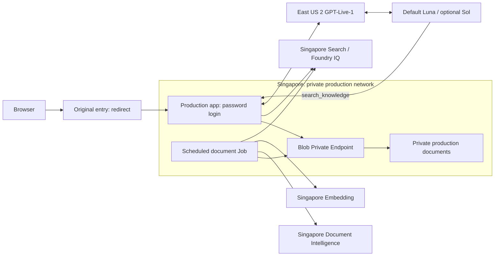

# Production release

Production app: `https://gpt-live-studio-prod.politeisland-5c1098a5.southeastasia.azurecontainerapps.io`.
Original entry (redirect): `https://gpt-live-studio.wonderfulwater-d017f2b1.southeastasia.azurecontainerapps.io`.
Existing password authentication is retained. Deployments use subscription `subscription1`, resource group `RG1`, and the Singapore VNet-enabled environment `gpt-live-prod-env`. The previous `realtime-psr-env` application is retained as a rollback target; after verification its landing page redirects to the new production application.

## Components

| Component | Resource / configuration |
| --- | --- |
| Web + voice backend | `gpt-live-studio-prod`, one replica; password login |
| Document worker | `gpt-live-knowledge-worker`, scheduled Container Apps Job every minute |
| Production documents | `glragprod678b10`, private container `gpt-live-prod`; Blob Private Endpoint, public network disabled, managed identity, no shared key or anonymous access |
| Worker/data identity | `gpt-live-rag-prod` |
| Search / Foundry IQ | Existing `gptlive-rag-dev-678b10` service, dedicated `gpt-live-prod-*` index/source/base objects |
| OCR | Existing `gptlive-ocr-dev-678b10` in Singapore |
| Embedding | Existing `foundry-asia2026` / `gpt-live-dev-embedding` in Singapore |
| Voice / Responses | Existing East US 2 endpoint; `gpt-live-1`, default `gpt-6-luna`, optional `gpt-live-dev-sol` |

The initial production knowledge base is empty. Local Azurite documents are never packaged or uploaded by deployment. Production and local development have different storage and index prefixes. Search/OCR/Embedding service instances are shared; deleting the knowledge base removes only its dedicated objects. An inherited Azure Policy disables Storage public networking, so `infra/production-network.bicep` provides a dedicated VNet, Blob Private Endpoint and private DNS zone link. No policy exemptions or policy changes are used.

The worker uses `Dockerfile.worker`, LibreOffice, Noto CJK fonts and `/app/.venv` with pinned `requirements-knowledge.txt`. It polls the persistent Blob manifest under an exclusive lease. Scheduled executions exit if another worker owns the lease, or after 15 seconds idle. Each job has a 1,800-second platform timeout and a 1,500-second application budget before beginning another document. Queued work can wait approximately one schedule interval plus container startup. No public worker endpoint is exposed.

## Release procedure

1. Run `npm run check`, `npm test`, `npm run build` and `npm run test:e2e`. Run the password test against a separate local password-auth server; never change the production password to test it.
2. Verify Git contents and Docker build context exclude `.env`, `.venv`, `.knowledge-tmp`, output files and `infra/*.parameters.local.json`.
3. Preserve current `az containerapp show` output in private `.azure/`; retain the previous image and revision for rollback.
4. Validate `infra/knowledge-storage.bicep`, `infra/production-network.bicep` and `infra/knowledge-worker.bicep`. Create storage/identity and private network/environment with the templates. Grant the identity `AcrPull` on the registry, `Cognitive Services User` on OCR and `Cognitive Services OpenAI User` on the embedding resource. The storage template grants `Storage Blob Data Contributor` only on production storage.
5. Build app and worker in ACR with an immutable release tag using `Dockerfile` and `Dockerfile.worker`. Supply the Search key through a secure Bicep parameter or Container Apps secret; never through Git or logs.
6. Deploy the worker template with the production storage, identity, Search/OCR/Embedding settings. Verify a successful execution and processing of non-sensitive release fixtures before switching app traffic.
7. Deploy `infra/main.bicep` as `gpt-live-studio-prod` in the new environment with the production data identity for both registry and data access. Supply knowledge parameters and preserve the original auth password hash and Foundry key through private parameters. `AZURE_CLIENT_ID`, production storage and Search/OCR/Embedding settings are emitted by the template.
8. Set `RESPONSES_DEPLOYMENT=gpt-6-luna`, `RESPONSES_DEPLOYMENTS=gpt-6-luna,gpt-live-dev-sol`. Confirm revision health, unauthenticated access rejection and authenticated UI defaults. Only then update the original app to the release image with `STUDIO_REDIRECT_ORIGIN` pointing to the new HTTPS origin. Roll back the original app by restoring its preserved image and removing `STUDIO_REDIRECT_ORIGIN`. Do not delete document storage during rollback.

First-release images: `rtpsr678b10.azurecr.io/gpt-live-studio:kb-20261014-2` and `rtpsr678b10.azurecr.io/gpt-live-worker:kb-20261014-1`.
Local development continues to use the private `.env` and Azurite. See [KNOWLEDGE.md](KNOWLEDGE.md) for local commands, and [KNOWLEDGE-VALIDATION.md](KNOWLEDGE-VALIDATION.md) for earlier validation and remaining conversation-quality limits.

## Verified release

The production-image smoke execution `gpt-live-release-smoke-tae2gea` completed at `2026-10-14T16:18:29Z`. It ran in a temporary private-network Job using the production image and identity, with a loopback-only test server. Markdown and Chinese Word fixtures passed upload, LibreOffice/Python validation, OCR, embedding and indexing. Full-document and IQ sessions both returned correct cited answers and real voice audio (102 and 226 audio events respectively), closed normally, and reported no errors. Both fixtures were deleted through the document API and worker before completion. No real microphone or user documents were used.

The public production endpoint returns 200 for health and login, and 401 for unauthenticated config/knowledge requests. Password login/logout was separately tested with an isolated local test password; production password hashes were preserved. This release does not claim completed human listening, prolonged interruption tests or maximum-context stress testing.

